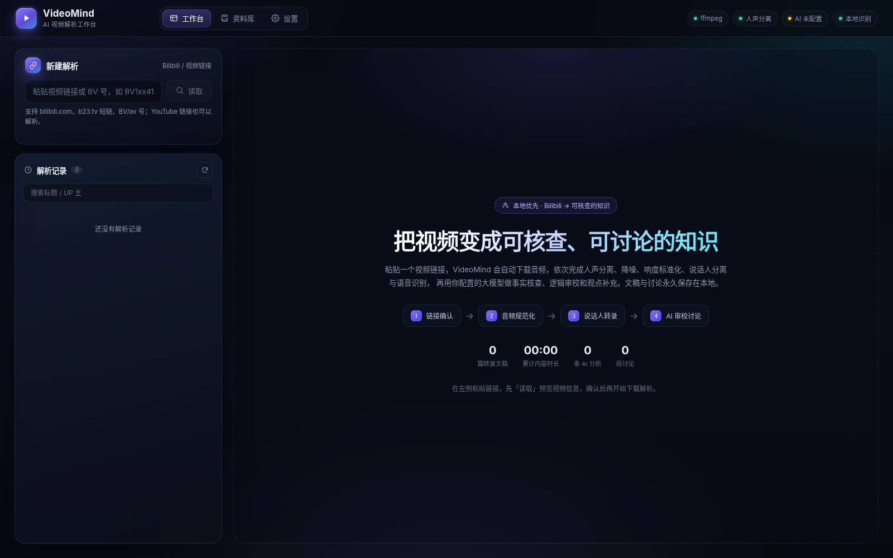
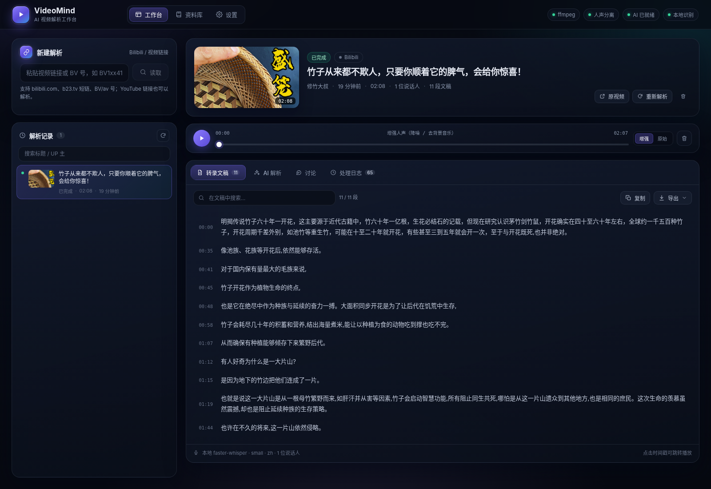
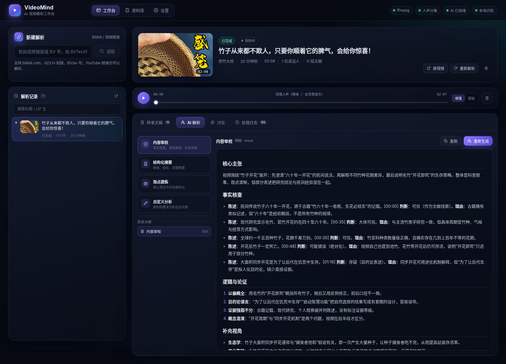
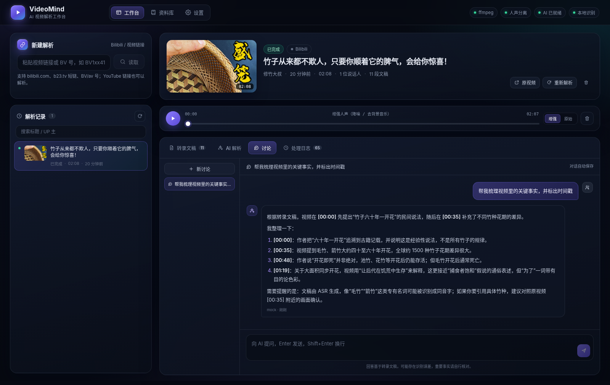
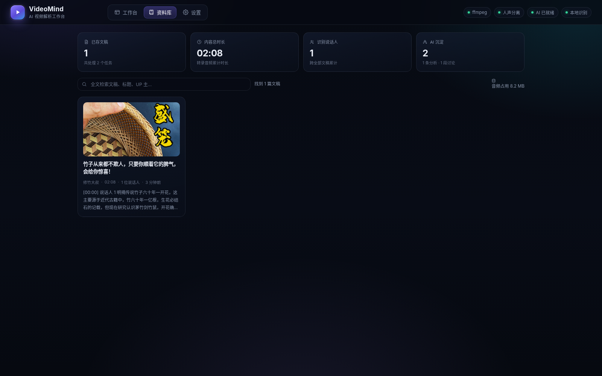

# VideoMind

**把视频变成可核查、可讨论、可检索的本地知识。**

输入一个 Bilibili（或 yt-dlp 支持的其它站点）链接，VideoMind 会下载音频，先做完整的声音规范化（去背景音乐、降噪、响度标准化），再做说话人分离与语音识别，最后用你配置的大模型做内容审校、结构化摘要、观点提炼和多轮讨论。所有文稿、分析与讨论都保存在本地。

<p align="center">
  
</p>

## 为什么做这个项目

很多视频转写工具是“下载音频 → 直接 ASR”。在真实视频里，背景音乐、环境噪声、多人对话、音量忽大忽小都会显著拉低识别质量。VideoMind 把音频规范化与说话人分离作为一等公民，并在此基础上提供 AI 审校与可追溯的讨论，而不是只给一段没有上下文的文字。

- **本地优先**：默认本地 ASR、本地人声分离、本地 SQLite；LLM 只在你配置后才调用。
- **可降级**：GPU 不可用、模型太大、内存不足时自动回退 CPU / 小模型，不会让整条流水线失败。
- **可追溯**：时间戳、说话人、原始视频链接、AI 分析历史、讨论记录都在本地保留。
- **可持续**：任务可以暂停、继续、终止；音频可以删除，文稿与讨论永久保留。

## 功能

- **确认后下载**：先读取标题、封面、时长，确认后才创建任务；下载与处理在后台队列执行。
- **完整音频规范化**：Demucs 人声分离（抑制 BGM）→ noisereduce 降噪 → EBU R128 响度标准化 → 16kHz 单声道。
- **离线说话人分离**：sherpa-onnx 的 pyannote 分割 + 3D-Speaker 声纹聚类，不需要 HuggingFace Token。
- **带时间戳的文稿**：faster-whisper 词级时间戳与说话人轮次对齐；支持搜索、复制、Markdown/TXT/SRT/JSON 导出。
- **AI 内容审校**：事实核查（可信 / 存疑 / 可能错误 / 无法核实）、逻辑与论证问题、补充视角、延伸问题。
- **流式讨论**：基于文稿的多会话问答；长文稿自动选取相关片段；回答引用时间戳。
- **思考过程可见**：推理型模型的 `reasoning_content` 会实时显示在独立的“思考中”面板，不会混进最终分析。
- **模型配置档案**：保存多组 Base URL / 模型 / Key（打码显示），一键切换、测试、删除。
- **暂停 / 继续 / 终止**：按阶段检查点恢复，已完成阶段不重做；服务重启后暂停状态仍保留。
- **本地资料库**：跨文稿全文检索、时长/说话人/音频占用统计。
- **多种后端**：本地 faster-whisper 或 OpenAI 兼容云端 ASR；DeepSeek / OpenAI / Qwen / Moonshot / Ollama 等 OpenAI 兼容 LLM。

## 界面

| 任务详情 | AI 内容审校 |
| --- | --- |
|  |  |

| 基于文稿讨论 | 资料库检索 |
| --- | --- |
|  |  |

> 截图中的视频为公开演示素材；AI 回复由本地 mock LLM 生成，用于展示界面与流式效果。真实使用需要配置你自己的模型。

## 架构

```
┌──────────────────────────── Browser (React) ────────────────────────────┐
│  新建解析  任务进度  文稿（说话人/时间戳）  AI 解析  讨论  资料库  设置     │
└───────────────▲──────────────────────────────────────────▲──────────────┘
                │ REST / SSE                                │
┌───────────────┴──────────────────────────────────────────┴──────────────┐
│ FastAPI                                                                  │
│  /api/videos/probe   /api/tasks   /api/transcripts   /api/library        │
│  /api/llm-profiles   /api/conversations   /api/settings   /api/system    │
│                                                                          │
│  JobManager（单 worker 默认）                                             │
│    └─ download → extract → separate → denoise → normalize → diarize      │
│        → transcribe → finalize                                          │
│                                                                          │
│  SQLite (WAL)  videos / tasks / task_events / transcripts / segments      │
│                analyses / conversations / messages / llm_profiles         │
│  Files         data/audio/<task_id>/source.* + enhanced.mp3               │
└──────────────────────────────────────────────────────────────────────────┘
```

更完整的需求映射、GitHub 调研与算法说明见 [docs/DESIGN.md](docs/DESIGN.md)，原始需求见 [docs/REQUIREMENTS.md](docs/REQUIREMENTS.md)。

## 处理流水线

```
prepare
  → download      yt-dlp 获取最佳音轨
  → extract       ffmpeg 解码为 44.1kHz 双声道
  → separate      Demucs htdemucs，保留 vocals 轨（可关闭）
  → denoise       noisereduce 频谱门限（可关闭）
  → normalize     ffmpeg loudnorm → 16kHz 单声道
  → diarize       sherpa-onnx 说话人分割 + 声纹聚类
  → transcribe    faster-whisper（本地）或 OpenAI 兼容云端 ASR
  → finalize      词级时间戳与说话人轮次对齐、合并、入库
```

- 每个增强阶段独立可关；失败只记 warning 并回退上一级音频。
- Demucs 按 60 秒分块、降噪按 5 分钟分块，带重叠交叉淡化，长视频不会整段读入内存。
- 重试复用已下载的 `source.*`；暂停/继续复用已完成阶段的中间产物。
- 音频可随时删除，文稿、分析与讨论不受影响。

## 快速开始

### 环境要求

- Python **3.11+**（在 3.13 上验证）
- **ffmpeg / ffprobe**（`sudo apt install ffmpeg`，macOS：`brew install ffmpeg`）
- Node.js **18+**（仅构建前端需要）
- 可选 NVIDIA GPU（详见 [GPU](#gpu-加速可选)）

### 安装

```bash
git clone https://github.com/HiFAN515/AI-Video-analysis.git
cd AI-Video-analysis
bash scripts/install.sh
```

安装脚本会：

1. 创建 `.venv`；
2. 安装后端依赖（固定 `av==15.1.0`，规避 faster-whisper 与新 PyAV 的 API 变化）；
3. 如果没有 torch，安装 CPU 版 PyTorch；
4. 以 `--no-deps` 安装 Demucs 及其依赖，避免引入 ABI 不匹配的 torchaudio；
5. `npm install && npm run build` 构建前端。

国内网络可指定镜像：

```bash
PIP_INDEX=https://mirrors.aliyun.com/pypi/simple/ bash scripts/install.sh
```

前端已在 `frontend/.npmrc` 中默认使用 npmmirror。

### 启动

```bash
bash scripts/start.sh
# 打开 http://127.0.0.1:7860
```

开发模式（后端热重载 + Vite HMR）：

```bash
bash scripts/dev.sh
```

`start.sh` 会自动加载 CUDA 12 运行库路径（如果已安装），并在终端打印检测到的 GPU；可通过 `VM_HOST` / `VM_PORT` 修改监听地址。

### 首次使用

1. 打开「设置」→ 填写 LLM Base URL、模型名、API Key，点「测试连接」。
2. 左侧粘贴 Bilibili 链接或 BV 号，点「读取」确认信息。
3. 展开「处理选项」，按需选择人声分离、降噪、说话人数、ASR 模型、是否删除音频。
4. 点「开始下载并解析」，在任务页查看进度和日志。
5. 转录完成后，在「转录文稿」中检索/导出；在「AI 解析」中生成审校、摘要或观点提炼；在「讨论」中继续追问。

## 配置

所有配置都可以在网页「设置」中完成，并写入本地 SQLite；初始默认值可用 `VM_` 前缀的环境变量或 `.env` 覆盖：

```bash
cp .env.example .env
```

| 变量 | 默认 | 说明 |
| --- | --- | --- |
| `VM_HOST` / `VM_PORT` | `127.0.0.1` / `7860` | 监听地址 |
| `VM_LLM_BASE_URL` | `https://api.deepseek.com/v1` | OpenAI 兼容接口 |
| `VM_LLM_API_KEY` | 空 | 建议在设置页填写 |
| `VM_LLM_MODEL` | `deepseek-chat` | 模型名 |
| `VM_LLM_TEMPERATURE` | `0.3` | 温度 |
| `VM_ASR_BACKEND` | `local` | `local` / `cloud` |
| `VM_ASR_MODEL` | `small` | `tiny/base/small/medium/large-v3/...` 或本地路径 |
| `VM_ASR_DEVICE` / `VM_ASR_COMPUTE_TYPE` | `cpu` / `int8` | GPU 可用 `cuda` / `float16` |
| `VM_AUDIO_DEVICE` | `auto` | Demucs 设备：`auto` / `cpu` / `cuda` |
| `VM_CLOUD_ASR_*` | OpenAI 默认 | 云端 ASR 的 Base URL / Key / 模型 |
| `VM_PROXY` | 环境代理 | yt-dlp、模型下载、LLM 请求代理 |
| `VM_COOKIES_FILE` | 空 | Bilibili 登录态 cookies.txt |
| `VM_MAX_CONCURRENT_JOBS` | `1` | 并发任务数（CPU 建议 1） |

> API Key 仅保存在本机 `data/app.db`，接口返回时打码。服务默认只监听 `127.0.0.1`，不要直接暴露到公网。

## GPU 加速（可选）

### Demucs 人声分离

设置页「人声分离设备」选择 `auto` 或 `cuda`。htdemucs 权重约 80MB，8GB 显存即可运行；代码按 60 秒分块，显存不足会自动回退 CPU。

`scripts/install.sh` 默认安装 CPU 版 PyTorch。要让 Demucs 使用 GPU，请安装与驱动匹配的 CUDA 版 PyTorch，例如：

```bash
.venv/bin/pip install torch --index-url https://download.pytorch.org/whl/cu124
```


### faster-whisper 语音识别

设置页「设备」选 `cuda`、精度选 `float16`。如果 CUDA 不可用、显存不足或库不匹配，会自动回退 CPU int8，并降级过大的模型。

### 为什么 CUDA 13 会报 `libcublas.so.12 not found`？

faster-whisper 底层使用 **CTranslate2 4.x**，它的 Linux wheel 按 **CUDA 12** 构建，运行时需要 `libcublas.so.12` 和 `libcudnn.so.9`。如果机器只有 CUDA 13（例如 torch 的 `cu130` 构建，提供 `libcublas.so.13`），动态链接器不会把 `.so.13` 当作 `.so.12`，于是报错。

解决方式：在项目虚拟环境安装 CUDA 12 用户态运行库（不需要 root）：

```bash
.venv/bin/pip install nvidia-cublas-cu12 nvidia-cudnn-cu12
```

`start.sh` 会自动把 venv 内 `nvidia/cublas/lib` 和 `nvidia/cudnn/lib` 加入 `LD_LIBRARY_PATH`。检查：

```bash
source scripts/_cuda_env.sh
.venv/bin/python scripts/check_gpu.py
```

预期看到 `libcublas.so.12: OK`、`libcudnn.so.9: OK`、`torch.cuda.is_available(): True` 和 CTranslate2 的 CUDA 设备数。

也可以在安装时直接带上：

```bash
INSTALL_CUDA12=1 bash scripts/install.sh
```

> 如果应用运行在容器/沙箱中，需要把宿主机的 `/dev/nvidia*` 映射进容器；否则即使库齐全也无法访问 GPU。
>
> 只给 Demucs 用 GPU、ASR 用 CPU 时，不需要 CUDA 12 库：Demucs 直接使用 PyTorch 的 CUDA 运行时。

### 8GB 显存建议

- Demucs：`htdemucs` 可用。
- ASR：`small` 或 `medium` + `float16`。
- `large-v3` 在显存低于 12GB 时会自动降级；CPU 模式下可用内存低于 10GB 也会降级，低于 3GB 时跳过 Demucs。
- 降噪是 CPU 频谱算法，不占 GPU；真正吃 GPU 的是 Demucs 和 ASR。

## 暂停 / 继续 / 终止

- 运行中点击「暂停」，会在当前分块或识别片段结束后生效，状态变为「已暂停」。
- 「继续」从最近检查点恢复；已完成的下载、提取、人声分离、降噪、响度标准化、说话人分离和识别结果会复用。
- 如果暂停发生在某阶段中间，会重做该阶段；界面会明确提示。
- 「终止」在当前检查点停止，保留已下载音频，不生成文稿。
- 暂停状态持久化，服务重启后仍可继续。

> 下载和 sherpa-onnx 原生说话人分离只能在阶段结束时响应暂停/终止；其余阶段通常在一个分块或一个识别片段内响应。

## AI 解析与讨论

### 分析类型

| 类型 | 提示词重点 |
| --- | --- |
| 内容审校 | 事实核查、逻辑漏洞、证据强度、补充视角、延伸问题 |
| 结构化摘要 | 一句话概括、内容脉络、关键结论/数据、值得记住的句子 |
| 观点提炼 | 核心观点、论据、时间戳、可信度标记、视频没有回答的问题 |
| 自定义分析 | 按用户要求分析，仍要求引用时间戳、不得编造 |

- 点击类型会自动生成；已有同类结果会打开历史；点「重新生成」可以重跑。
- 每条分析独立保存，不会覆盖旧记录；删除任务或重试文稿时才会级联删除。
- 推理型模型（如 `deepseek-reasoner`）会先输出思考过程：界面实时显示「模型正在思考 · 已等待 N 秒」，正文在思考结束后单独流式输出。
- 如果希望首字更快，可以换用非推理模型（如 `deepseek-chat`）。

### 长文稿

- 分析上下文限制约 9 万字符，超出时保留头尾并明确标注。
- 讨论在长文稿下使用关键词检索选取相关片段（`pipeline/transcript.py::select_relevant`）。

### 模型配置档案

设置页顶部显示当前生效的 Base URL / 模型 / Key（打码）/ 温度；下方「已保存的模型配置」列出所有保存过的组合，支持「使用」「测试」「删除」。保存设置时会自动记录；升级前已有的配置也会自动补录。

## 数据与隐私

- 转录、分析、讨论保存在 `data/app.db`（SQLite WAL）。
- 音频与模型缓存在 `data/`、`models/`、`.cache/`，均在 `.gitignore` 中。
- API Key 仅存本地数据库；接口返回打码；没有遥测或云端同步。
- 删除音频只删除文件，文稿、AI 分析与讨论保留。
- 任务级联删除会删除对应文稿、分析、讨论和事件。

> 开源/提交前请确认不要提交 `data/`、`models/`、`.cache/`、`.env`、`frontend/dist/`、`frontend/node_modules/`。仓库的 `.gitignore` 已覆盖这些目录。安全说明见 [SECURITY.md](SECURITY.md)。

## 性能参考

参考环境：CPU-only，8+ 核，16GB 内存；实际耗时取决于视频长度、模型与 CPU。

| 项目 | 参考结果 |
| --- | --- |
| Demucs 分离 30 秒音频 | 约 15 秒 |
| 说话人分离 127 秒音频 | 约 15 秒 |
| faster-whisper `small` int8，127 秒音频 | 约 21 秒（≈6× 实时） |
| faster-whisper `large-v3` int8，127 秒音频 | 约 88 秒（≈1.4× 实时） |
| 15 分钟视频完整流程（CPU） | 约 10–15 分钟 |

GPU 主要加速 Demucs 与 ASR；说话人分离与降噪仍在 CPU。实际数字以你的硬件为准。

## 项目结构

```
backend/
  app/
    main.py                 FastAPI 入口 + 静态前端
    config.py               环境变量配置
    db.py / models.py       SQLite + ORM + 轻量迁移
    schemas.py              Pydantic API 模型
    api/                    tasks / transcripts / library / system / profiles / media
    pipeline/               downloader / audio / diarization / asr / transcript / pipeline
    services/               jobs / llm / prompts / settings_store
  requirements.txt
  tests/                    对齐、URL、文本处理单元测试
frontend/
  src/                      React + TypeScript 单页应用
  src/components/           新建任务 / 任务详情 / 文稿 / 分析 / 讨论 / 资料库 / 设置
  public/favicon.svg
docs/
  DESIGN.md                 需求映射、开源调研、架构与算法
  REQUIREMENTS.md           原始需求
  assets/                   界面截图
scripts/
  install.sh                安装依赖与构建
  start.sh                  生产模式启动（自动加载 CUDA 12 环境）
  dev.sh                    开发模式（后端 reload + Vite）
  _cuda_env.sh              CUDA 12 运行库路径
  check_gpu.py              GPU / CUDA 12 / CTranslate2 诊断
  mock_llm.py               无 API Key 时演示界面
data/                       运行时数据库与音频（gitignored）
models/                     运行时模型缓存（gitignored）
```

## REST API

启动后访问 `http://127.0.0.1:7860/api/docs` 查看完整 OpenAPI 文档。

```bash
# 读取视频信息（不下载）
curl -X POST http://127.0.0.1:7860/api/videos/probe \
  -H 'Content-Type: application/json' \
  -d '{"url":"BV1xx411c7mD"}'

# 创建任务
curl -X POST http://127.0.0.1:7860/api/tasks \
  -H 'Content-Type: application/json' \
  -d '{"url":"BV1xx411c7mD","options":{"bgm_separation":true,"denoise":true,"diarization":true,"delete_audio":false}}'

# 查看任务 / 暂停 / 继续 / 终止 / 重试
curl http://127.0.0.1:7860/api/tasks/<task_id>
curl -X POST http://127.0.0.1:7860/api/tasks/<task_id>/pause
curl -X POST http://127.0.0.1:7860/api/tasks/<task_id>/resume
curl -X POST http://127.0.0.1:7860/api/tasks/<task_id>/cancel
curl -X POST http://127.0.0.1:7860/api/tasks/<task_id>/retry

# 导出文稿
curl -o transcript.md http://127.0.0.1:7860/api/transcripts/<id>/export?format=md

# AI 分析（SSE）
curl -N -X POST http://127.0.0.1:7860/api/transcripts/<id>/analyses/stream \
  -H 'Content-Type: application/json' \
  -d '{"kind":"review"}'
```

主要端点：

```
POST /api/videos/probe
POST /api/tasks
GET  /api/tasks?status=
GET  /api/tasks/{id}
POST /api/tasks/{id}/pause|resume|cancel|retry
DELETE /api/tasks/{id}              # 级联删除
DELETE /api/tasks/{id}/audio        # 只删音频
GET  /api/tasks/{id}/audio?variant=enhanced|source
GET  /api/transcripts/{id}
GET  /api/transcripts/{id}/export?format=md|txt|srt|json
GET/POST /api/transcripts/{id}/analyses[/stream]
GET/POST /api/transcripts/{id}/conversations
POST /api/conversations/{id}/messages/stream
GET  /api/library?q=
GET  /api/library/stats
GET/PUT /api/settings
POST /api/settings/test-llm
GET/POST /api/llm-profiles
POST /api/llm-profiles/{id}/activate|test
DELETE /api/llm-profiles/{id}
GET  /api/system/health|info|asr-models
GET  /api/media/cover?url=          # 封面代理
```

## 开发与测试

后端单元测试（无需 GPU/网络）：

```bash
cd backend
../.venv/bin/python -m unittest discover -s tests -v
```

前端类型检查与构建：

```bash
cd frontend
npm run build
```

GPU 诊断：

```bash
source scripts/_cuda_env.sh
.venv/bin/python scripts/check_gpu.py
```

没有 API Key 时，可以启动 mock LLM 体验完整界面（回复是固定演示文本）：

```bash
.venv/bin/python scripts/mock_llm.py   # 127.0.0.1:8001
# 设置页 Base URL: http://127.0.0.1:8001/v1，模型: mock，Key 随便填
```

## 常见问题

**安装时 pip 卡在 av / 下载很慢？**
项目固定 `av==15.1.0`（faster-whisper 1.2.1 与 PyAV 19 的 `metadata_errors` 变更不兼容）。国内建议使用阿里云镜像。

**Demucs 报 torchaudio / undefined symbol？**
Demucs 的 openunmix 会在导入时 `import torchaudio`，但 htdemucs 实际不调用它。项目在 `audio.py` 中注入兼容垫片，并故意不安装 torchaudio；如果不小心装了不匹配的 torchaudio，卸载即可。

**有 GPU 仍报 `libcublas.so.12 not found`？**
CTranslate2 需要 CUDA 12 的 `libcublas.so.12`，CUDA 13 的 `libcublas.so.13` 不能替代。按 [GPU 章节](#为什么-cuda-13-会报-libcublasso12-not-found) 安装 `nvidia-cublas-cu12` / `nvidia-cudnn-cu12`，并用 `start.sh` 启动。

**Bilibili 视频下载失败？**
部分高码率、会员或需要登录的视频需要 cookies。用浏览器扩展导出 `cookies.txt`，`VM_COOKIES_FILE=/path/to/cookies.txt` 后重启。

**识别文本有错别字？**
ASR 的同音字/专有名词错误无法完全避免。AI 审校提示词要求区分“转录识别错误”和“观点本身有问题”；也可以换用 `medium` / `large-v3` 或云端 ASR。

**长视频的 AI 分析会截断吗？**
超过约 9 万字符会保留头尾并标注；讨论使用关键词检索选取相关片段。

**如何删除音频但保留文稿？**
任务页音频栏右侧垃圾桶，或新建任务时勾选「完成后删除音频」；删除后文稿、AI 分析与讨论不受影响。

**AI 分析点了没反应？**
推理型模型会先思考 30–90 秒；界面会显示「模型正在思考 · 已等待 N 秒」。如果一直没有正文，请确认模型名正确、Key 有余额，并查看任务页/浏览器控制台错误。


## 致谢

[yt-dlp](https://github.com/yt-dlp/yt-dlp) · [Demucs](https://github.com/adefossez/demucs) · [faster-whisper](https://github.com/SYSTRAN/faster-whisper) · [sherpa-onnx](https://github.com/k2-fsa/sherpa-onnx) · [noisereduce](https://github.com/turian/noisereduce) · [FastAPI](https://fastapi.tiangolo.com/) · [React](https://react.dev/) · [BiliNote](https://github.com/JefferyHcool/BiliNote) / [bilibili2text](https://github.com/KKKZOZ/bilibili2text)（交互与领域参考）

## License

[MIT](LICENSE)。请遵守视频平台的服务条款与版权规定，仅处理你有权使用的内容。

